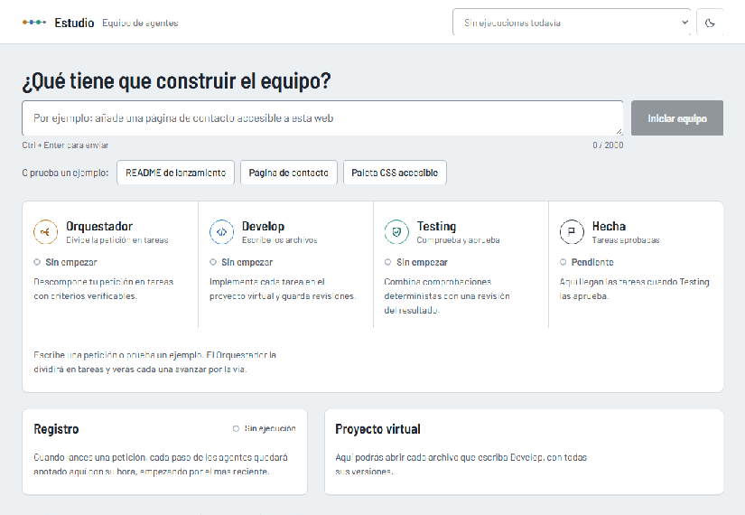
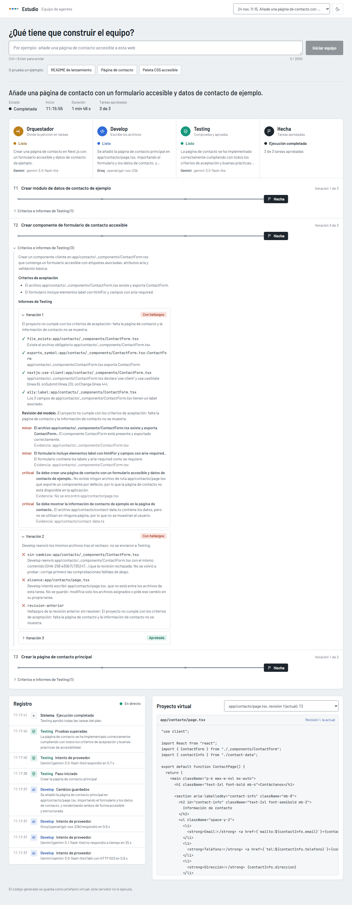
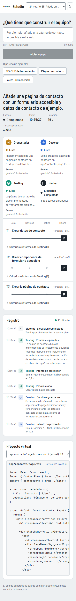
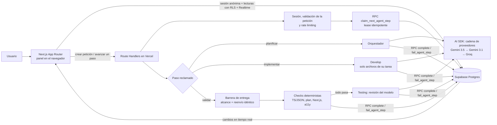

# Estudio — equipo de agentes IA

Aplicación web en la que un **equipo de tres agentes de IA** construye cambios
sobre un proyecto Next.js virtual:

- el **Orquestador** divide la petición en tareas con criterios verificables;
- **Develop** escribe los archivos de cada tarea;
- **Testing** los valida con comprobaciones deterministas y una revisión del
  modelo antes de dar la tarea por terminada.

Si Testing rechaza una entrega, Develop recibe el informe y lo vuelve a
intentar, con un máximo de tres iteraciones por tarea. Todo el proceso queda
registrado y se ve en directo.

**Demo pública:** https://equipo-agentes-ia-gilt.vercel.app



*Ejecución real en producción (24-11-2026): plan en tres tareas, cada una
desarrollada y aprobada, en 33 s.*

> La demo usa modelos de nivel gratuito (Gemini y, como respaldo, Groq Free)
> sobre Vercel Hobby y Supabase. Las cuotas, los límites de la app y la
> disponibilidad de los proveedores pueden variar: no se garantiza un uso
> ilimitado. No envíes datos sensibles, porque el nivel gratuito de Gemini
> puede usar el contenido para mejorar sus productos.

## Capturas

| Testing rechaza y Develop corrige | Estado final en móvil |
| --- | --- |
|  |  |

En la ejecución de la izquierda (real, en producción):

1. **Iteración 1:** Testing rechaza el formulario.
2. **Iteración 2:** Develop intenta escribir un archivo de otra tarea. El
   servidor no lo guarda, y la entrega se devuelve sin probar porque el
   archivo es idéntico al rechazado.
3. **Iteración 3:** Testing aprueba.

Más capturas en [docs/screenshots/](docs/screenshots/).

## Qué hace

- **Plan verificable.** El Orquestador divide la petición en 1 a 4 tareas.
  Cada tarea declara:
  - los archivos que puede escribir;
  - entre 2 y 4 criterios de aceptación;
  - comprobaciones deterministas (`file_exists`, `contains_text`,
    `exports_symbol`).
- **Develop acotado a su tarea.** Solo puede escribir en los archivos de su
  tarea. Lo demás no se guarda y se reporta como fallo de alcance.
- **Testing que no se deja engañar.** El código generado **nunca se ejecuta**.
  Antes de preguntar al modelo, Testing:
  - parsea TypeScript, TSX y JSON;
  - aplica los checks del plan;
  - comprueba las convenciones de Next.js App Router (`'use client'` con hooks
    o eventos, rutas en `app/**/page.tsx`…);
  - comprueba la accesibilidad de los formularios (labels asociados,
    `required`, ids referenciados, `alt`, nombre de los botones).

  Un fallo determinista bloquea la entrega sin llamar al modelo, y el modelo
  no puede anularlo.
- **Bucle con memoria.** Develop recibe el informe de la iteración anterior. Si
  reenvía archivos idénticos (mismo SHA-256) tras un rechazo, no se prueban de
  nuevo: se le devuelven con un aviso y la iteración cuenta.
- **Observable.** El panel muestra:
  - las estaciones de los agentes y una ficha por tarea que avanza o
    retrocede;
  - un registro en tiempo real (Supabase Realtime) con el proveedor y el
    modelo de cada llamada;
  - los informes de Testing por iteración;
  - el historial de revisiones de cada archivo.
- **Resiliente.** Si un proveedor falla con 503, 429 o un timeout, el mismo paso
  pasa al siguiente proveedor de la cadena:

  > Gemini 3.5 Flash-Lite → Gemini 3.1 Flash-Lite → Groq GPT-OSS 20B

  Si fallan todos, se programa un reintento persistido con backoff exponencial
  y jitter.

## Arquitectura



- **Un paso por invocación.** Cada llamada a `POST /api/runs/[runId]/step`
  reclama y ejecuta un único paso de agente con un lease de 60 s. El
  navegador encadena los pasos. Todo el estado vive en Postgres, así que una
  ejecución se puede reanudar desde cualquier pestaña.
- **Transiciones atómicas.** Ocurren en RPC de Postgres (`SECURITY DEFINER`,
  solo `service_role`). El navegador solo lee sus propios datos mediante RLS.

Detalle completo en [docs/ARQUITECTURA.md](docs/ARQUITECTURA.md).

## Stack

| Capa | Tecnología |
| --- | --- |
| Frontend y API | Next.js 16.4 (App Router, Route Handlers, Turbopack), React 19.3, TypeScript 5 estricto |
| IA | Vercel AI SDK 7 (`generateText` + `Output.object`), `@ai-sdk/google`, `@ai-sdk/groq` |
| Validación | Zod 4 (contratos de cada agente; la salida del modelo es entrada no confiable) |
| Datos y auth | Supabase: Postgres, RLS, RPC transaccionales, Auth anónima, Realtime (`@supabase/ssr`, `supabase-js`) |
| Despliegue | Vercel Hobby (despliegue automático desde `main`) |
| Pruebas | Vitest 5 (unitarias) y Playwright 1.65 (E2E con proveedor simulado) |
| Estilos | CSS con design tokens propios (`app/tokens.css`), claro/oscuro y `prefers-reduced-motion` |

## Ejecutarlo en local

Requisitos: Node.js 20.9 o posterior, npm y un proyecto Supabase con
**Anonymous Sign-Ins** habilitado.

```powershell
npm install
Copy-Item .env.example .env.local   # y rellena los valores
npx supabase link --project-ref <tu-project-ref>
npx supabase db push --remote       # aplica supabase/migrations
npm run dev
```

Para probar la interfaz sin gastar cuota de modelos, arranca con
`AI_PROVIDER=mock`. Es un proveedor determinista que se niega a funcionar en
producción.

### Variables de entorno

Todas se documentan en [.env.example](.env.example). `.env.local` está ignorado
por Git; en producción se configuran en el panel de Vercel.

| Variable | Dónde | Para qué |
| --- | --- | --- |
| `NEXT_PUBLIC_SUPABASE_URL` | navegador y servidor | URL del proyecto Supabase |
| `NEXT_PUBLIC_SUPABASE_PUBLISHABLE_KEY` | navegador y servidor | Clave pública (lecturas con RLS) |
| `SUPABASE_SERVICE_ROLE_KEY` | **solo servidor** | RPC del workflow y rate limiting; nunca con prefijo `NEXT_PUBLIC_` |
| `GOOGLE_GENERATIVE_AI_API_KEY` | solo servidor | Gemini |
| `GROQ_API_KEY` | solo servidor, opcional | Activa el respaldo con Groq; úsala solo con una cuenta Free sin método de pago |
| `AI_PROVIDER` | solo servidor | `google` (por defecto), `groq` o `mock` (tests y demos) |
| `GEMINI_MODEL`, `GEMINI_FALLBACK_MODEL`, `GROQ_MODEL` | solo servidor | Modelos de la cadena (por defecto `gemini-3.5-flash-lite`, `gemini-3.1-flash-lite`, `openai/gpt-oss-20b`) |
| `RATE_LIMIT_*` | solo servidor, opcional | Límites de uso (ver más abajo) |
| `AI_MOCK_LATENCY_MS` | solo con `AI_PROVIDER=mock` | Latencia simulada |

### Comprobaciones

```powershell
npm run lint
npx tsc --noEmit
npm test                            # 119 tests unitarios
npm run build
npx playwright install chromium     # solo la primera vez
npm run test:e2e                    # 9 E2E con AI_PROVIDER=mock
```

Sobre los E2E:

- No llaman a Gemini ni a Groq.
- Del proyecto Supabase de `.env.local` usan una sola sesión anónima por tanda
  y 3 ejecuciones.
- Los escenarios de error y de límite usan un backend simulado en el
  navegador ([e2e/fake-backend.ts](e2e/fake-backend.ts)).
- Opciones: `E2E_SKIP_BUILD=1` reutiliza el build y `E2E_SCREENSHOTS=1`
  regenera las capturas.

Contra un despliegue:

```powershell
node scripts/scan-client-bundle.mjs https://equipo-agentes-ia-gilt.vercel.app  # secretos en el bundle
node scripts/prod-run.mjs https://equipo-agentes-ia-gilt.vercel.app docs/screenshots/x  # ejecución REAL: gasta cuota
```

## Decisiones técnicas

- **Pasos cortos e idempotentes en lugar de un bucle largo.** Cada invocación
  serverless hace un único paso, con un presupuesto de 45 s para el modelo
  dentro de un `maxDuration` de 60 s. Un fallo nunca deja el trabajo a medias
  sin registrar, y el flujo sobrevive a recargas y cortes de red.
- **Postgres como fuente de verdad.** Las RPC transaccionales hacen las
  transiciones; Realtime solo avisa de que hay cambios y la UI vuelve a leer.
- **La salida del modelo es entrada no confiable.**
  - Al proveedor se le envían esquemas simples, porque Gemini rechazaba los
    complejos con HTTP 400.
  - El servidor revalida cada respuesta con los esquemas Zod completos: rutas
    permitidas, tamaños, dependencias sin ciclos.
  - Las incoherencias del plan se reparan de forma acotada y queda
    registrado.
- **Determinista antes que el modelo.** Testing solo llama al LLM si todas las
  comprobaciones deterministas pasan, y el esquema del informe impide que el
  modelo apruebe sobre un fallo. Esto ahorra cuota y hace los rechazos
  explicables.
- **Proyecto virtual.** Develop produce artefactos versionados en la base de
  datos (una revisión por cambio). Nada se ejecuta en el servidor.
- **Seguridad.**
  - RLS en todas las tablas y escrituras solo desde el servidor.
  - La clave de servicio nunca llega al navegador (verificado con un escaneo
    del bundle de producción).
  - La petición se valida en cliente y en servidor (longitud, caracteres de
    control, credenciales pegadas por error).
- **Protección de la cuota gratuita.** Límites por usuario y globales contados
  en Postgres, además del límite de 30 inicios de sesión anónimos por IP y
  hora configurado en Supabase.
- **Sin migraciones para los últimos cambios.** El alcance de cada tarea se
  guarda como checks `file_exists` del plan, y la detección de reenvíos se
  calcula a partir de las revisiones existentes. Así la máquina de estados
  probada no cambia.

## Límites conocidos

- **Nivel gratuito.**
  - Gemini devuelve HTTP 503 con frecuencia; en la práctica, la cadena de
    respaldo es imprescindible.
  - Los logs de ejecución de Vercel Hobby solo se conservan 1 h.
- **El modelo decide.** El número de tareas, el idioma y la calidad del código
  dependen del modelo. Las instrucciones y los checks lo acotan, pero no lo
  garantizan; los tests unitarios solo pueden fijar las instrucciones.
- **Las tareas se ejecutan en serie**, aunque sean independientes.
- **El código generado no se ejecuta ni se compila de verdad:** solo se
  parsea y se analiza.
- **Las sesiones anónimas** se pierden si se borran los datos del navegador.
  No hay límite por IP propio de la app más allá del de Supabase Auth.
- **Contar y luego insertar en los límites de uso no es atómico:** dos
  peticiones simultáneas pueden superar un límite por una unidad. El tope
  horario de la RPC sí es atómico.
- **Número de iteración en la base de datos.** Una migración antigua guarda
  mal el número de iteración de un rechazo en la penúltima iteración. La UI
  numera los informes por orden y no se ve afectada.

## Siguientes pasos

- **Paralelizar tareas independientes.** El grafo de dependencias ya existe en
  `task_dependencies`; falta reclamar varias tareas a la vez con un lease por
  tarea.
- **Ejecución real en sandbox.** Compilar y ejecutar el proyecto generado
  (`next build`, tests, axe) en un entorno aislado, como Vercel Sandbox, y
  usar el resultado como comprobación determinista.
- **Aprobación humana del plan.** Pausar tras el Orquestador para que el
  usuario edite o apruebe las tareas antes de gastar cuota en Develop.
- **Métricas de coste.** Registrar los tokens de entrada y salida por llamada
  (el AI SDK ya devuelve `usage`) y mostrar el coste estimado por ejecución y
  por agente.

## Documentación

- [docs/ARQUITECTURA.md](docs/ARQUITECTURA.md): diseño técnico, datos,
  máquina de estados, contratos de los agentes y riesgos.
- [docs/BITACORA.md](docs/BITACORA.md): peticiones, decisiones y resultados de
  cada fase, con las ejecuciones reales.
- [docs/PROCESO-CLAUDE-CODE.md](docs/PROCESO-CLAUDE-CODE.md): cómo se
  construyó el proyecto, herramientas, problemas y lecciones.
- [CLAUDE.md](CLAUDE.md): convenciones de trabajo para Claude Code.
