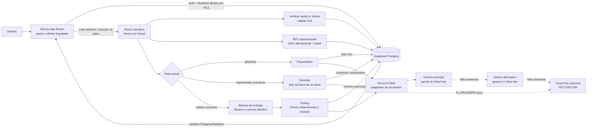
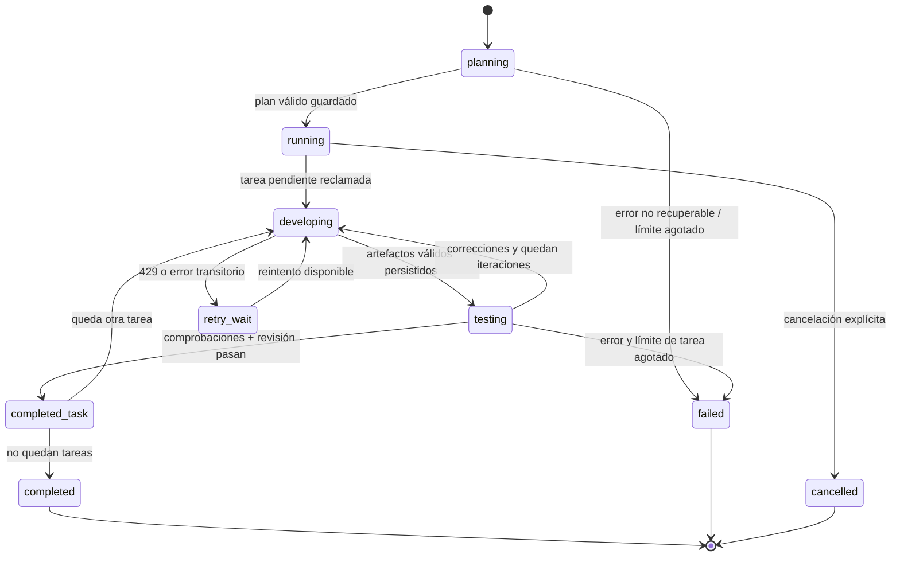

# Arquitectura

> Estado: implementada y desplegada en producción en
> https://equipo-agentes-ia-gilt.vercel.app (Vercel Hobby y Supabase).
>
> El documento nació como la propuesta de la Fase 0 y se ha ido actualizando
> con lo que se aprobó e implementó en cada fase:
>
> - UI (Fases 3 y 3.5);
> - calidad (Fase 4);
> - despliegue y convenciones de Testing (Fase 5);
> - alcance de Develop y barrera de entrega (Fase 5.5).
>
> El historial de decisiones está en [BITACORA.md](BITACORA.md).

## Objetivo y límites

Una aplicación web de demostración que recibe una petición de cambio para un
proyecto virtual de ejemplo y coordina tres agentes: Orquestador, Develop y
Testing. Develop produce parches versionados en la base de datos, no ejecuta ni
escribe directamente en el sistema de archivos del servidor. Testing aplica
validaciones deterministas a esos artefactos y criterios, además de revisión por
LLM. La UI presenta el progreso y el historial.

Cada invocación procesa como máximo una transición de agente. El workflow se
persiste en Postgres y se puede reanudar; una función serverless nunca ejecuta
el ciclo completo de principio a fin. La API implementa `POST /api/runs` para
crear una ejecución y `POST /api/runs/[runId]/step` para reclamar y ejecutar
un único paso.

## Arquitectura



Las RPC `create_agent_run`, `claim_next_agent_step`, `complete_agent_step` y
`fail_agent_step` mantienen las transiciones atómicas en Postgres. El claim usa
un idempotency key por paso e iteración, un lease de 60 segundos (máximo que
admite la RPC; la ruta declara `maxDuration = 60`) y un lock por
run antes de llamar al modelo. La finalización guarda plan/artefactos/informe,
actualiza estados y registra eventos en la misma transacción; las llamadas
repetidas no duplican artefactos ni completan dos veces el mismo intento.
Errores transitorios se guardan como `next_attempt_at` con backoff
exponencial acotado y jitter; no se mantiene una función dormida. El cliente
reanuda cuando llega el momento. Agotados los reintentos de proveedor, el paso
queda en error visible y recuperable, no en un estado de éxito aparente.
Los endpoints exigen una sesión Supabase válida. `create_agent_run` limita a
cinco runs por propietario y hora con un lock transaccional. Se complementa
con:

- los límites de la app por usuario y globales (ver «Rate limiting»);
- el límite de 30 inicios de sesión anónimos por IP y hora configurado en
  Supabase Auth.

## Modelo de datos propuesto

- `runs`: `id`, `owner_id` (Supabase Auth), petición original, estado global,
  versión del esquema, `max_task_iterations`, marcas de tiempo y error final.
- `agent_tasks`: `id`, `run_id`, orden, título, descripción, criterios legibles
  y comprobaciones deterministas tipadas en `acceptance_criteria`
  (`{criteria, checks}`), estado, iteración actual/límite e informe de test más
  reciente. Los archivos que la tarea puede escribir se guardan como checks
  `file_exists`; el alcance de la tarea es el conjunto de rutas de sus checks.
- `artifacts`: `id`, `run_id`, `task_id`, ruta virtual, número de revisión,
  contenido de texto y autor. Inmutable por revisión; el conjunto de revisiones
  más recientes por ruta representa el proyecto virtual.
- `agent_events`: `id`, `run_id`, `task_id` nullable, agente, tipo de evento,
  resumen de entrada/salida, metadatos y `created_at`. Los eventos Testing
  incluirán el informe estructurado completo y el número de iteración, para
  conservar el historial Develop↔Testing sin sobrescribir informes anteriores.
  No se guardan claves de proveedor; los informes y resúmenes pueden contener
  texto derivado de la petición o los artefactos, por lo que no se deben enviar
  datos sensibles.
- `step_attempts`: clave idempotente, agente y tarea, intento de proveedor,
  estado, lease y fecha de próximo reintento. Una fila por intento permite
  auditar las llamadas y los errores sin guardar claves ni respuestas crudas
  del proveedor.

RLS se activa en todas las tablas. En la primera migración, el usuario autenticado
solo puede leer sus runs, tareas, dependencias, artefactos, intentos y eventos;
las escrituras del workflow quedan reservadas al servidor. Las rutas de servidor
deben verificar sesión y propiedad antes de usar la clave elevada, que se
mantiene solo en entorno servidor y nunca se expone al navegador. La publicación
de Realtime incluye únicamente las tablas necesarias y las suscripciones
respetan RLS. El demo usa sesiones anónimas de Supabase Auth; perder los datos
del navegador implica perder el acceso a esa sesión.

Los nombres concretos de la migración inicial son `agent_runs`, `agent_tasks`,
`task_dependencies`, `artifacts`, `agent_events` y `step_attempts`. Se limita
`max_task_iterations` a 1–5 en base de datos (valor inicial 3), se versionan
artefactos inmutables y se deniegan escrituras directas a roles de navegador.

## Máquina de estados



Estados visibles de tarea: `pending`, `developing`, `testing`, `failed`,
`completed`. Los errores transitorios se muestran como subestado de actividad
(«Esperando reintento»). Si una tarea agota sus iteraciones o un paso termina
en error no recuperable, el run falla y las tareas restantes quedan
pendientes; así no se reporta el run como completado cuando una tarea falló.

Límite inicial: tres iteraciones Develop↔Testing por tarea, incluyendo la
primera entrega de Develop. El valor se guarda en el run y no se cambia a mitad
del flujo. Cada invocación recorre la cadena de proveedores completa: con
`AI_PROVIDER=google`, Gemini principal → Gemini alternativo → Groq opcional;
con `AI_PROVIDER=groq`, Groq precede a los dos Gemini. Un error transitorio
(timeout o HTTP 408, 425, 429, 500, 502, 503 o 504) pasa **inmediatamente** al
siguiente proveedor dentro de la misma invocación, sin esperar ni consumir un
reintento persistido. Un error permanente, como HTTP 400, termina el paso.
Solo si todos los proveedores fallan de forma transitoria se persiste un
reintento con backoff exponencial y jitter; el máximo sigue siendo cuatro
intentos persistidos por paso, y cada uno vuelve a empezar por el principio de
la cadena. El SDK no activa reintentos internos.

Presupuesto de tiempo por invocación: Vercel Hobby con Fluid compute permite
hasta 300 s, pero el límite efectivo es el lease de 60 s. Las llamadas a modelo
disponen de 45 s contados desde el inicio de la petición; el resto cubre auth,
claim, carga de artefactos y persistencia. Cada llamada usa
`min(timeout del proveedor, presupuesto restante)` con 25 s para Gemini y 30 s
para Groq, y no se inicia un proveedor si quedan menos de 8 s.

## Contratos de agentes y verificación

Cada agente tiene prompt de sistema y esquema Zod propio. Los tres reciben el
contexto del proyecto (Next.js App Router con TypeScript) y la regla de escribir
todo texto legible en el idioma de la petición.

- **Plan**:
  - de 1 a 4 tareas ordenadas (2–4 cuando hay varios entregables);
  - dependencias si hacen falta;
  - los archivos que puede escribir cada tarea (1–4);
  - 2–4 criterios de aceptación verificables leyendo los archivos;
  - 1–3 checks deterministas.

  El servidor convierte los archivos declarados en checks `file_exists` y
  alinea los checks de una tarea que nombran el mismo archivo en carpetas
  distintas (`lib/agents/plan-consistency.ts`). Si repara algo, lo indica en el
  resumen del plan.
- **Develop**: artefactos `{ path, content }` para el sistema de archivos
  virtual y resumen del cambio. Solo admite rutas relativas permitidas,
  extensiones aprobadas y tamaños acotados. Recibe `allowedFiles` y el informe
  de la iteración anterior. Los archivos fuera de su alcance no se guardan y se
  registra un evento `scope_violation`.
- **Testing**: resultado estructurado, comprobaciones ejecutadas, hallazgos y
  decisión de revisión del modelo, con evidencia. La revisión juzga solo la
  tarea en curso, no el trabajo de las tareas siguientes.

Las aserciones generadas por el Orquestador se validan y limitan en servidor.
Un paso de Testing sigue este orden:

1. **Barrera de entrega** (`lib/agents/delivery-gate.ts`), sin llamar al modelo.
   - Las escrituras fuera de alcance de la iteración se reportan como
     `alcance:<ruta>`.
   - Si, tras un rechazo, todos los archivos entregados tienen el mismo SHA-256
     que su revisión anterior, el informe se devuelve sin probar.
     - Lleva el aviso `sin-cambios` y los fallos anteriores.
     - Cuenta como iteración, porque para la máquina de estados es un rechazo
       de Testing.

   Los archivos de la entrega se identifican por la marca de tiempo del evento
   `development_completed`, que comparten con sus artefactos al escribirse en
   la misma transacción.
2. **Comprobaciones deterministas**, sin ejecutar el código.
   - Parseo de TypeScript/TSX (`transpileModule`) y JSON.
   - Checks del plan.
   - Convenciones (`lib/validation/conventions.ts`, sobre el AST):
     - Next.js App Router: nada de `pages/`, export por defecto en
       `page`/`layout`, `'use client'` con hooks o eventos, nada de `metadata`
       en componentes de cliente.
     - Accesibilidad: labels asociados, `required` cuando el label lo indica,
       ids referenciados, `alt` y nombre de los botones.
   - Las convenciones se aplican solo a los archivos cuya última revisión
     escribió la tarea.
3. **Revisión del modelo**, solo si todo lo anterior pasa.

Un esquema Zod exige que tanto los checks como la revisión pasen para aprobar.
El LLM no puede anular fallos deterministas ni producir por sí solo el estado
`completed`.

Los esquemas que se envían al proveedor son deliberadamente simples para
mantenerse dentro del subconjunto de JSON Schema y los límites de complejidad
de Gemini. Después de cada respuesta, el servidor valida de nuevo con los
esquemas completos, que aplican longitudes, rutas, dependencias y reglas de
negocio.

`AI_PROVIDER` elige el proveedor prioritario: Google por defecto, o Groq cuando
se selecciona explícitamente. Con Google, `GEMINI_MODEL` (default
`gemini-3.5-flash-lite`) precede a `GEMINI_FALLBACK_MODEL` (default
`gemini-3.1-flash-lite`). Si `GROQ_API_KEY` está configurada, la cadena añade
`GROQ_MODEL` (default `openai/gpt-oss-20b`); `AI_MODEL` solo se acepta como
alias heredado para Groq cuando `AI_PROVIDER=groq`, para evitar que un modelo
Gemini antiguo se use por error con Groq. Ambos modelos Gemini tienen soporte
documentado de structured outputs y precios de nivel gratuito estándar; Google advierte que
puede usar los datos del nivel gratuito para mejorar productos. Groq documenta
strict structured output para GPT-OSS 20B, pero también publica precios de uso
de pago. En esta implementación solo debe configurarse como fallback una
cuenta Groq Free sin método de pago; el usuario confirmó esa condición para su
cuenta y que la cuota agotada devuelve 429. Los límites exactos dependen de la
organización y se deben verificar en su consola. Nunca se deben enviar datos
sensibles. El prompt de sistema se envía en el campo `system`; Groq recibe
`structuredOutputs` y `strictJsonSchema` explícitamente activados. Los timeouts
por proveedor se describen arriba y los reintentos internos del SDK están
desactivados. Cada proveedor probado registra un evento `provider_attempt` en
`agent_events` con modelo, posición en la cadena, resultado, código HTTP y
duración, y la UI muestra el último intento por agente. La salida de cada entrega Develop limita el contenido combinado a
20 000 caracteres; el contexto virtual acumulado se limita a 20 archivos y
48 000 caracteres para evitar prompts sin límite.

## Estructura de carpetas

```text
app/
  api/runs/route.ts              # crear ejecución: validación y rate limiting
  api/runs/[runId]/step/route.ts # un paso: claim, agente, barrera, persistencia
  layout.tsx, page.tsx, tokens.css, globals.css
components/
  dashboard.tsx      # sesión, Realtime, avance de pasos y avisos
  run-track.tsx      # estaciones de agentes, fichas e informes por iteración
  event-timeline.tsx, code-viewer.tsx, notice.tsx, agent-identity.tsx, theme-toggle.tsx
lib/
  agents/            # prompts, esquemas Zod, plan-consistency, delivery-gate
  ai/                # cadena de proveedores, errores, proveedor simulado
  validation/        # FS virtual, convenciones Next.js/a11y, validación de la petición
  rate-limit/        # política y conteo en Postgres
  errors/, http/     # catálogo de mensajes y respuestas de error de la API
  orchestration/     # backoff y reglas puras
  dashboard/         # presentación de estados y eventos
  supabase/          # clientes navegador/servidor/servicio
supabase/migrations/ # esquema, RLS y RPC del workflow
e2e/                 # Playwright: setup de sesión, flujos y backend simulado
scripts/             # vitest.mjs, scan-client-bundle.mjs, prod-run.mjs, diagnose-gemini.ts
docs/                # ARQUITECTURA, BITACORA, PROCESO-CLAUDE-CODE, capturas y GIF
```

La ruta API no acepta instrucciones arbitrarias de agente desde el navegador.
El navegador impulsa un paso cada vez; todas las migraciones están aplicadas al
proyecto enlazado.

## Despliegue

- **Vercel Hobby.** Proyecto `equipo-agentes-ia`, que despliega
  automáticamente cada push a `main` en la región `iad1`. Las variables de
  producción se configuran en el panel de Vercel: allí no se definen
  `RATE_LIMIT_*` ni `AI_MOCK_*`, así que se usan los límites por defecto, y
  `AI_PROVIDER=mock` está bloqueado con `VERCEL_ENV=production`.
- **Supabase.**
  - Usa el proyecto existente con las migraciones de `supabase/migrations`.
  - Anonymous Sign-Ins activado, con un límite de 30 por IP y hora.
  - Site URL apuntando al dominio de producción. La app no usa redirecciones
    de Auth, pero así no queda `localhost`.
- **Verificación.**
  - `scripts/scan-client-bundle.mjs` comprueba que el bundle del cliente no
    contiene claves de servidor.
  - `scripts/prod-run.mjs` lanza una ejecución real con Playwright y guarda el
    registro y las capturas.

## Interfaz (Fase 3, rediseñada en la Fase 3.5)

Dirección visual «Sala de control». Los design tokens (color, tipografía,
espaciado, radios, sombras, duraciones y curvas) viven solo en `app/tokens.css`;
`app/globals.css` los consume.

- Barra de petición con tres ejemplos, validación visible y respuesta a
  errores y límites.
- Cabecera de la ejecución: la petición como título, estado, inicio, duración y
  tareas aprobadas.
- Vía de cuatro estaciones (Orquestador, Develop, Testing, Hecha). Cada agente
  tiene color e icono propios, iguales en estaciones, fichas y registro. El
  color indica el agente; la forma de la lámpara indica el estado.
- Cada tarea es una ficha sobre su carril: en cola, Develop, Testing o Hecha.
  Avanza, y retrocede cuando Testing la rechaza. Sustituye al tablero de cinco
  columnas, que casi siempre tenía cuatro vacías. Los criterios y los informes
  de Testing por iteración se despliegan bajo el carril.
- Registro con lo más reciente arriba y visor del proyecto virtual con
  selección de ruta y revisión de artefacto.
- Skeletons mientras carga una ejecución y estados vacíos que explican qué
  aparecerá y cómo empezar.
- Suscripción Realtime filtrada por `run_id`, protegida por RLS; carga inicial,
  refetch en cambios y al reconectar. Postgres es la fuente de verdad.
- Sesión anónima persistente en el navegador, selector de últimas ejecuciones y
  botón para reanudar un run no terminal.
- Diseño responsive con tema claro/oscuro aplicado antes del primer pintado,
  contraste AA verificado para todo el texto (3:1 para bordes de controles),
  foco visible, enlace para saltar al contenido, regiones de estado y texto
  además del color.
- Movimiento solo con propósito y solo sobre `transform`/`opacity`. La ficha
  se desliza entre estaciones (280 ms, curva ease-in-out) con una transición
  CSS interrumpible. La lámpara late mientras el agente trabaja. Los eventos
  nuevos entran desde arriba (160 ms). Los botones responden a la pulsación
  con `scale(0.97)`. Con `prefers-reduced-motion` se eliminan los
  desplazamientos y se conservan los cambios de color y opacidad.

La migración `20261124140000_store_testing_iteration_reports.sql` guarda
`p_result` y la iteración en los metadatos del evento Testing; el usuario
confirmó su aplicación remota. La migración
`20261124160000_allow_groq_fallback_retry.sql` eleva a cuatro el límite de
reintentos tanto en el RPC de claim como en el RPC de fallo; el usuario confirmó
su aplicación y `migration list --remote` la muestra aplicada.
La migración `20261126170000_align_agent_task_acceptance_criteria.sql` convierte
las filas antiguas al objeto `{criteria, checks}` y alinea su restricción con el
formato que escribe `complete_agent_step`; el usuario confirmó su aplicación y
una consulta remota read-only verificó la restricción.

## Calidad (Fase 4)

### Errores para el usuario

- Las rutas devuelven `{ code, error, detail, retryAfterSeconds? }` y la cabecera
  `Retry-After` cuando esperar ayuda (`lib/http/api-error.ts`). El catálogo
  `lib/errors/user-messages.ts` traduce cada código a título, explicación y una
  única acción: volver a lanzar, reanudar, recargar o editar la petición. Lo
  comparten el cliente y el servidor.
- Los fallos persistidos de un run se explican a partir del `errorCode` de sus
  eventos `agent_failed`/`retry_scheduled`: cuota agotada (429), proveedor
  caído (5xx), timeout, salida mal formada o inválida, límite de iteraciones o
  de tamaño. Si el claim agota los reintentos sin código, se usa la causa del
  último reintento. Mientras hay un reintento en curso, un aviso neutro explica
  la causa y muestra una cuenta atrás.
- El navegador limita cada `fetch` (75 s por paso, 20 s al crear), reintenta en
  silencio hasta dos veces los 5xx y los cortes de red (los pasos son
  idempotentes) y trata el 429 de pasos como una pausa, no como un fallo.

### Validación de la petición

`lib/validation/run-request.ts` se ejecuta en el navegador y de nuevo en el
servidor. Normaliza (NFC, saltos de línea, espacios) y exige entre 10 y 2000
caracteres (la BD admite 4000, pero la petición se repite en cada prompt).
Rechaza caracteres de control, texto sin palabras o repetitivo, y credenciales
reconocibles (claves de Google, Groq, OpenAI/Anthropic, Supabase, GitHub, AWS,
JWT y claves privadas PEM), porque el texto se envía a un modelo externo. La
ruta exige `application/json` (415), limita el cuerpo a 16 KiB (413) y solo
acepta el campo `request`.

### Rate limiting

Se cuenta en Postgres con el cliente de servicio, porque las instancias
serverless no comparten memoria (`lib/rate-limit/`). Ventanas deslizantes; los
límites se configuran con variables `RATE_LIMIT_*`:

| Límite | Defecto | Al superarlo |
| --- | --- | --- |
| Runs por usuario y hora | 5 (además, fijo en el RPC con lock) | 429 `run_rate_limited_hour` |
| Runs por usuario y 24 h | 15 | 429 `run_rate_limited_day` |
| Runs globales en 24 h | 150 | 429 `global_quota_exhausted` |
| Pasos con modelo por usuario y minuto | 10 | 429 `step_rate_limited` (el navegador espera) |
| Pasos con modelo por usuario y 24 h | 200 | 429 `step_quota_exhausted` |

Solo cuentan los intentos reclamados, que son los que llaman a un modelo, y el
paso final que marca el run como completado nunca se bloquea. Contar y luego
insertar no es atómico: dos peticiones simultáneas pueden superar un límite por
una unidad. El tope horario sigue siendo atómico en el RPC. Si el conteo falla,
la ruta responde 503 en lugar de dejar pasar la petición. Las sesiones anónimas
son baratas de crear: el límite global es el que acota de verdad el consumo; no
hay límite por IP.

### Proveedor simulado y E2E

`AI_PROVIDER=mock` sustituye la cadena por `MockLanguageModelV4` (`ai/test`)
con salidas deterministas que cumplen los checks del plan (`lib/ai/mock-model.ts`).
Se niega a arrancar si `VERCEL_ENV=production`. Marcadores en la petición
simulan fallos: `[simular:cuota]`, `[simular:caida]`, `[simular:timeout]`,
`[simular:formato]`, `[simular:iteracion]` y `[simular:alcance-y-reenvio]`. Este
último hace que Develop escriba fuera de su tarea, reenvíe sin cambios y
después lo corrija. Playwright (`e2e/`) construye la
app, la arranca con el mock y nunca reutiliza un servidor existente, para no
gastar cuota real. Del proyecto Supabase de `.env.local` usa:

- Una sesión anónima por tanda, abierta en el proyecto `setup` y compartida
  mediante `storageState`.
- Tres runs reales (cuatro con capturas): flujo principal, alcance y reenvío,
  e iteración. Se quedan por debajo del límite de 5 runs por propietario y
  hora.

Los escenarios de fallo y de límite usan `e2e/fake-backend.ts`. Simula en el
navegador la API, las lecturas PostgREST (mismas filas que escriben las RPC) y
un socket Realtime que nunca responde.

## Riesgos y mitigaciones

| Riesgo | Mitigación propuesta |
| --- | --- |
| Cuotas gratuitas cambian o se agotan | Configuración por entorno, backoff con jitter, límites de petición e iteración, errores visibles; no asumir cuota ilimitada. |
| Límite de duración serverless | Un paso acotado por invocación, persistencia previa, claim/lease idempotente y reanudación. |
| Dos clientes procesan el mismo run | RPC/transacción de claim, lease y escrituras condicionales; pruebas de concurrencia. |
| Acceso a datos de otros usuarios | Auth, RLS por `owner_id`, claves secretas solo en servidor y pruebas de políticas. |
| Salida del modelo peligrosa o excesiva | Zod, allowlist de rutas, límites de tamaño y parser; no ejecutar el código generado. |
| Criterios vagos | El plan contiene criterios legibles y aserciones deterministas tipadas; Testing devuelve evidencia. |
| Coste/abuso en endpoint público | Límites de runs por usuario (hora y día) y globales, de pasos con modelo por usuario (minuto y día), de cuerpo/contexto/tokens e iteraciones, y 30 inicios de sesión anónimos por IP y hora en Supabase Auth. |
| Develop pisa archivos de otras tareas o repite entregas | Alcance por tarea: lo de fuera no se guarda y Testing lo reporta. Un reenvío idéntico tras un rechazo no se vuelve a probar. |
| Realtime duplica o pierde eventos | Postgres como fuente de verdad, carga inicial, reconexión/refetch y eventos append-only. |
| Modelo/proveedor deja de ser compatible | Adaptador separado y pruebas simuladas; secretos y selección por variables. |
| Groq podría generar cargos en una cuenta con facturación | El fallback solo debe configurarse con cuenta Free sin método de pago; confirmar límites en consola y no asumir que las cuotas son ilimitadas. |
| Publicar gratis no equivale a garantía de disponibilidad | Verificar elegibilidad, límites de Vercel Hobby/Supabase y URL al desplegar; documentar límites. |

## Fuentes consultadas

- [Next.js Route Handlers](https://nextjs.org/docs/app/api-reference/file-conventions/route)
- [AI SDK: generación de salidas estructuradas](https://ai-sdk.dev/docs/ai-sdk-core/generating-structured-data)
- [AI SDK: proveedor Google/Gemini](https://ai-sdk.dev/providers/ai-sdk-providers/google)
- [Supabase Realtime: Postgres Changes](https://supabase.com/docs/guides/realtime/postgres-changes)
- [Supabase SSR: cliente Next.js y sesiones en cookies](https://supabase.com/docs/guides/auth/server-side/creating-a-client)
- [Supabase Auth: sesiones anónimas](https://supabase.com/docs/guides/auth/auth-anonymous)
- [Supabase CLI: migraciones locales](https://supabase.com/docs/guides/local-development/database-migrations)
- [Supabase Postgres: RLS y grants](https://supabase.com/docs/guides/database/postgres/row-level-security)
- [Next.js: archivo Proxy](https://nextjs.org/docs/app/api-reference/file-conventions/proxy)
- [Gemini API: modelo Gemini 3.5 Flash-Lite](https://ai.google.dev/gemini-api/docs/models/gemini-3.5-flash-lite)
- [Gemini API: modelo Gemini 3.1 Flash-Lite](https://ai.google.dev/gemini-api/docs/models/gemini-3.1-flash-lite)
- [Gemini API: precios](https://ai.google.dev/gemini-api/docs/pricing)
- [Groq: strict structured outputs](https://console.groq.com/docs/structured-outputs)
- [Groq: modelos y precios](https://console.groq.com/docs/models)
- [Groq: rate limits](https://console.groq.com/docs/rate-limits)

- [AI SDK: testing con `MockLanguageModelV4`](https://ai-sdk.dev/docs/ai-sdk-core/testing)
- [Playwright: autenticación con proyecto `setup` y `storageState`](https://playwright.dev/docs/auth)
- [Playwright: `webServer`](https://playwright.dev/docs/test-webserver)
- [Playwright: `WebSocketRoute` (`routeWebSocket`)](https://playwright.dev/docs/api/class-websocketroute)

En las Fases 0–3 (hechas con GitHub Copilot) Context7 y los MCP de Supabase y
Vercel no estaban disponibles y se consultó la documentación oficial
directamente. Desde que se usa Claude Code, la documentación de librerías se
consulta con Context7 y el despliegue se revisa con el MCP de Vercel (ver
[PROCESO-CLAUDE-CODE.md](PROCESO-CLAUDE-CODE.md)).
