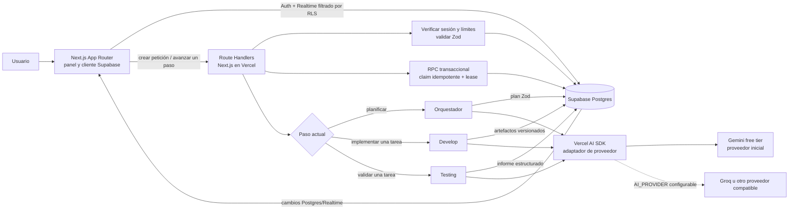
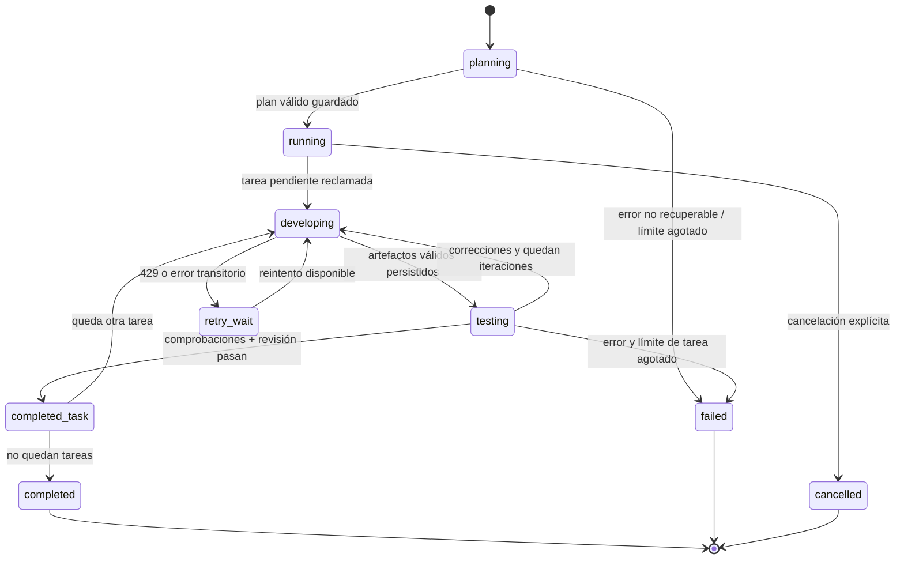

# Propuesta de arquitectura (Fase 0)

> Estado: propuesta aprobada. La base y el núcleo de agentes se están
> implementando por fases; no se debe inferir que la aplicación esté desplegada.

## Objetivo y límites

Una aplicación web de demostración que recibe una petición de cambio para un
proyecto virtual de ejemplo y coordina tres agentes: Orquestador, Develop y
Testing. Develop produce parches versionados en la base de datos, no ejecuta ni
escribe directamente en el sistema de archivos del servidor. Testing aplica
validaciones deterministas a esos artefactos y criterios, además de revisión por
LLM. La UI presenta el progreso y el historial.

Cada invocación procesa como máximo una transición de agente. El workflow se
persiste en Postgres y se puede reanudar; una función serverless nunca ejecuta
el ciclo completo de principio a fin. La API implementa `POST /api/runs` para
crear una ejecución y `POST /api/runs/[runId]/step` para reclamar y ejecutar
un único paso.

## Arquitectura



Las RPC `create_agent_run`, `claim_next_agent_step`, `complete_agent_step` y
`fail_agent_step` mantienen las transiciones atómicas en Postgres. El claim usa
un idempotency key por paso e iteración, un lease de 45 segundos y un lock por
run antes de llamar al modelo. La finalización guarda plan/artefactos/informe,
actualiza estados y registra eventos en la misma transacción; las llamadas
repetidas no duplican artefactos ni completan dos veces el mismo intento.
Errores 429/transitorios se guardan como `next_attempt_at` con backoff
exponencial acotado y jitter; no se mantiene una función dormida. El cliente
reanuda cuando llega el momento. Agotados los reintentos de proveedor, el paso
queda en error visible y recuperable, no en un estado de éxito aparente.
Los endpoints exigen una sesión Supabase válida. `create_agent_run` limita a
cinco runs por propietario y hora con un lock transaccional; es una protección
básica por usuario, no una defensa completa contra creación masiva de cuentas.

## Modelo de datos propuesto

- `runs`: `id`, `owner_id` (Supabase Auth), petición original, estado global,
  versión del esquema, `max_task_iterations`, marcas de tiempo y error final.
- `agent_tasks`: `id`, `run_id`, orden, título, descripción, criterios legibles
  y comprobaciones deterministas tipadas en `acceptance_criteria`, estado,
  iteración actual/límite e informe de test más reciente.
- `artifacts`: `id`, `run_id`, `task_id`, ruta virtual, número de revisión,
  contenido de texto y autor. Inmutable por revisión; el conjunto de revisiones
  más recientes por ruta representa el proyecto virtual.
- `agent_events`: `id`, `run_id`, `task_id` nullable, agente, tipo de evento,
  resumen de entrada/salida, estado asociado y `created_at`. Sin claves ni
  contenidos sensibles.
- `step_attempts`: clave idempotente, agente y tarea, intento de proveedor,
  estado, lease y fecha de próximo reintento. Una fila por intento permite
  auditar las llamadas y los errores sin guardar claves ni respuestas crudas
  del proveedor.

RLS se activa en todas las tablas. En la primera migración, el usuario autenticado
solo puede leer sus runs, tareas, dependencias, artefactos, intentos y eventos;
las escrituras del workflow quedan reservadas al servidor. Las rutas de servidor
deben verificar sesión y propiedad antes de usar la clave elevada, que se
mantiene solo en entorno servidor y nunca se expone al navegador. La publicación
de Realtime incluye únicamente las tablas necesarias y las suscripciones
respetan RLS. El demo usa sesiones anónimas de Supabase Auth; perder los datos
del navegador implica perder el acceso a esa sesión.

Los nombres concretos de la migración inicial son `agent_runs`, `agent_tasks`,
`task_dependencies`, `artifacts`, `agent_events` y `step_attempts`. Se limita
`max_task_iterations` a 1–5 en base de datos (valor inicial 3), se versionan
artefactos inmutables y se deniegan escrituras directas a roles de navegador.

## Máquina de estados



Estados visibles de tarea: `pending`, `developing`, `testing`, `failed`,
`completed`. Errores transitorios pueden mostrarse como subestado de actividad
sin añadir un sexto estado al tablero. Si una tarea agota sus iteraciones o un
paso termina en error no recuperable, el run falla y las tareas restantes quedan
pendientes; así no se reporta el run como completado cuando una tarea falló.
Esta política se propone para la implementación.

Límite inicial: tres iteraciones Develop↔Testing por tarea, incluyendo la
primera entrega de Develop. El valor se guarda en el run y no se cambia a mitad
del flujo. Cada paso de proveedor tiene además un máximo de tres intentos.

## Contratos de agentes y verificación

Cada agente tiene prompt de sistema y esquema Zod propio:

- **Plan**: lista acotada de tareas ordenadas, dependencias (si hacen falta),
  criterios de aceptación legibles y aserciones verificables como archivo
  requerido o texto/import/export requerido.
- **Develop**: artefactos `{ path, content }` para el sistema de archivos virtual,
  resumen del cambio y relación con criterios. Solo rutas relativas permitidas,
  extensiones aprobadas y tamaños acotados.
- **Testing**: resultado estructurado, comprobaciones ejecutadas, hallazgos y
  decisión de revisión del modelo, incluyendo evidencia.

Las aserciones generadas por el Orquestador se validan y limitan en servidor.
Testing parsea TypeScript/TSX con TypeScript `transpileModule` (sin ejecutar el
código), JSON con `JSON.parse` y evalúa cada check (`file_exists`,
`contains_text` o `exports_symbol`). Cualquier fallo determinista impide
aprobar y evita gastar otra llamada al modelo. Si todos pasan, el LLM revisa el
parche frente a petición y criterios. Un esquema Zod exige que tanto los checks
como la revisión pasen para que el informe sea aprobado; el LLM no puede anular
fallos deterministas ni producir por sí solo el estado `completed`.

El proveedor se selecciona con `AI_PROVIDER` y el modelo con `AI_MODEL`; claves
separadas según proveedor (`GOOGLE_GENERATIVE_AI_API_KEY`, por ejemplo, o
`GROQ_API_KEY`). Un módulo adaptador concentra la selección y usa las
integraciones compatibles con Vercel AI SDK. La interfaz de agentes no debe
depender del proveedor concreto. El proveedor inicial y modelos exactos se
confirmarán al implementar, según disponibilidad y cuotas vigentes.
Las llamadas tienen timeout de 20 segundos y no usan reintentos internos del
SDK. La salida de cada entrega Develop limita el contenido combinado a 20 000
caracteres; el contexto virtual acumulado se limita a 20 archivos y 48 000
caracteres para evitar prompts sin límite.

## Estructura de carpetas propuesta

```text
app/
  api/runs/route.ts
  api/runs/[runId]/step/route.ts
  page.tsx                 # scaffold actual; panel en Fase 3
components/
  agents/
  runs/
  tasks/
  artifacts/
lib/
  agents/                 # prompts y esquemas Zod por agente
  orchestration/           # transiciones puras y reglas de iteración
  ai/                      # adaptador de proveedor y política de reintentos
  supabase/                 # clientes server/browser y tipos DB
  validation/               # validación del FS virtual
supabase/
  migrations/
tests/
  unit/
  e2e/
lib/**/*.test.ts           # pruebas Vitest actuales del núcleo
docs/
  ARQUITECTURA.md
  BITACORA.md
  PROCESO-CLAUDE-CODE.md
```

La ruta API no acepta instrucciones arbitrarias de agente desde el navegador.
Las RPC de workflow y su migración correctiva ya están aplicadas al proyecto
enlazado; el lint remoto no presenta errores. La UI en Fase 3 impulsará un paso
cada vez.

## Diseño de la interfaz

- Panel de escritorio de dos zonas: área de ejecución (petición y tablero de
  tareas) y área de actividad/código; en móvil, secciones apiladas y navegación
  por pestañas o acordeones.
- Formulario destacado con límites visibles, estado de envío y errores
  accionables.
- Tres tarjetas consistentes de agentes con indicador accesible de estado,
  última actividad y resumen; no simular actividad que no esté registrada.
- Tablero con estados `pending`, `developing`, `testing`, `failed` y `completed`,
  iteración actual/límite y vínculo al informe.
- Historial cronológico de eventos y revisiones; vista del código virtual con
  selector de archivo y diffs/revisiones.
- Suscripción Realtime por `run_id` más RLS; carga inicial por consulta y
  recuperación por refetch al reconectar. Realtime es una señal de actualización,
  no la única fuente de verdad.
- Accesibilidad: etiquetas y foco para controles, `aria-live` para cambios
  relevantes sin anunciar cada fragmento, contraste, teclado y estados no
  dependientes solo del color.

## Riesgos y mitigaciones

| Riesgo | Mitigación propuesta |
| --- | --- |
| Cuotas gratuitas cambian o se agotan | Configuración por entorno, backoff con jitter, límites de petición e iteración, errores visibles; no asumir cuota ilimitada. |
| Límite de duración serverless | Un paso acotado por invocación, persistencia previa, claim/lease idempotente y reanudación. |
| Dos clientes procesan el mismo run | RPC/transacción de claim, lease y escrituras condicionales; pruebas de concurrencia. |
| Acceso a datos de otros usuarios | Auth, RLS por `owner_id`, claves secretas solo en servidor y pruebas de políticas. |
| Salida del modelo peligrosa o excesiva | Zod, allowlist de rutas, límites de tamaño y parser; no ejecutar el código generado. |
| Criterios vagos | El plan contiene criterios legibles y aserciones deterministas tipadas; Testing devuelve evidencia. |
| Coste/abuso en endpoint público | Cinco runs por propietario/hora, límites de cuerpo/contexto/tokens e iteraciones; protección adicional por IP si la infraestructura lo permite. |
| Realtime duplica o pierde eventos | Postgres como fuente de verdad, carga inicial, reconexión/refetch y eventos append-only. |
| Modelo/proveedor deja de ser compatible | Adaptador separado y pruebas simuladas; secretos y selección por variables. |
| Publicar gratis no equivale a garantía de disponibilidad | Verificar elegibilidad, límites de Vercel Hobby/Supabase y URL al desplegar; documentar límites. |

## Fuentes consultadas

- [Next.js Route Handlers](https://nextjs.org/docs/app/api-reference/file-conventions/route)
- [AI SDK: generación de salidas estructuradas](https://ai-sdk.dev/docs/ai-sdk-core/generating-structured-data)
- [AI SDK: proveedor Google/Gemini](https://ai-sdk.dev/providers/ai-sdk-providers/google)
- [Supabase Realtime: Postgres Changes](https://supabase.com/docs/guides/realtime/postgres-changes)
- [Supabase SSR: cliente Next.js y sesiones en cookies](https://supabase.com/docs/guides/auth/server-side/creating-a-client)
- [Supabase Auth: sesiones anónimas](https://supabase.com/docs/guides/auth/auth-anonymous)
- [Supabase CLI: migraciones locales](https://supabase.com/docs/guides/local-development/database-migrations)
- [Supabase Postgres: RLS y grants](https://supabase.com/docs/guides/database/postgres/row-level-security)
- [Next.js: archivo Proxy](https://nextjs.org/docs/app/api-reference/file-conventions/proxy)

La búsqueda de herramientas de esta sesión no expuso Context7 ni los MCP de
gestión de Supabase/Vercel. Estas referencias se consultaron directamente en
documentación oficial disponible; antes de implementar se volverá a verificar
la documentación y, si los MCP requeridos están disponibles, se utilizarán para
las operaciones correspondientes.
